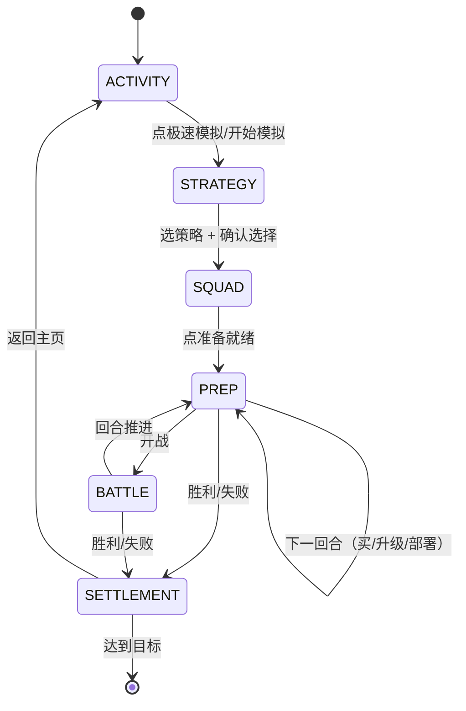

# 设计说明

## 1. 现状：MAA 的卫戍协议到底做了什么

MAA 主线（dev-v2，v6.22）对卫戍协议只有一个纯 JSON 任务链：
`resource/tasks/MiniGame/SPA.json`。

它的流程是：

```
活动主界面 → 极速模拟 → 开始模拟 → 选歌利亚/确认编队
  → LoopWaitStart（每 5s 轮询 ExitButton）
  → 第 5 回合（TurnFive 模板）
  → 点退出 → 确认 → 返回主页
```

也就是说，它**不操作对局**：不买干员、不升级、不布阵，
只是进入对局后等回合推进到第 5 回合，然后退出，靠「存活波次」拿卫戍认证。
这是有意的取舍——刷点数的速度最快，但**永远拿不到「通关 N 次」的蚀刻章和策略角标**。

社区里已经有两个方向的实现：

| 来源 | 做法 | 局限 |
| --- | --- | --- |
| MAA PR #19325（官方仓库分支 `feat/stronghold-protocol`） | 2300 行 C++ 插件，完整买卡/部署/结算，按角标选策略 | 尚未合并、只在 MAA 内可用、每步固定 sleep 较多 |
| MAA PR #19308 | 从小黑盒扩展翻译的 13k 行插件 + 大量资源数据 | 体量大、来源与许可需要额外说明 |
| GarrisonFarm（第三方） | 独立 Python 工具，MAA 设备配置 + PaddleOCR | 单文件 9 万字节、无项目级 LICENSE、每局约 15 分钟 |

本工具走第四条路：**独立 Python、复用 MAA 的坐标/模板、把「刷满所有角标」当成调度问题来做**，
并且把对局策略拆成可替换的数据驱动层，方便按赛季调参。

## 2. 总体结构

```
                 ┌──────────────┐
                 │   runner     │  状态机：场景 → 动作 → 记账
                 └──────┬───────┘
        ┌───────────────┼────────────────┐
        │               │                │
  ┌─────▼─────┐   ┌─────▼─────┐    ┌─────▼─────┐
  │perception │   │  battle   │    │ planner/  │
  │场景判定    │   │ 买/部署    │    │ tracker   │
  └─────┬─────┘   └─────┬─────┘    └───────────┘
        │               │
  ┌─────▼─────┐   ┌─────▼─────┐
  │ vision    │   │  device   │
  │模板/颜色   │   │adb/minitouch│
  └───────────┘   └───────────┘
```

- **识别统一在 1280×720 基准图**：模板只需一份，点击时再按实际分辨率换算。
  这比 MAA 的「模板按分辨率缩放」更简单，也避免 1600×900 这类非整数倍缩放误差。
- **perception 只做分类**，不做动作；battle 只做对局内动作，不做导航；
  runner 负责把两者串起来并记账。这样每一层都能单独测。
- **planner/tracker 是纯逻辑**，不依赖设备，单元测试覆盖。

## 3. 相对 MAA 的优化点

### 3.1 时间：把固定 sleep 换成事件驱动

MAA 的 JSON 链里 `LoopWaitStart` 是 `postDelay: 5000` + 每 5 秒判一次。
本工具：

- 场景轮询默认 250ms，休整/战斗按场景分别退避（战斗 1s）；
- 点击后等「状态变化」而不是等固定时间：
  升级看资金/按钮位移，买卡看资金变化，部署看「点击取消」出现；
- 结算识别失败才重试，正常路径只 OCR 一次。

保守估计单局可省 30~60 秒；60 局就是 30~60 分钟。

### 3.2 触控：minitouch 而不是 input tap

部署是「按住 → 移动抓起 → 拖到格位 → 松手 → 选朝向」。
`adb shell input tap/swipe` 每步都要起一个 shell，延迟 100ms+，而且无法表达「按住后持续移动」。
本工具直接使用 MAA 自带的 minitouch：

- 一次连接，后续指令走 socket；
- 支持 `d/m/u/w`，可以精确控制按住 350ms、每步 30ms；
- 部署预览时先拖到悬停点截图，确认绿色可放置格再落到目标格。

没有 minitouch 时退回 adb input，并明确提示部署可能失败。

### 3.3 调度：把「刷满所有角标」当成覆盖问题

`planner.BadgePlan` 的规则：

1. 只取前 `strategy_limit` 个策略（默认 20，对应蚀刻章的“20 个策略普通标识”）；
2. 按配置顺序，把每个策略补到 `per_strategy_clears`（默认 3）；
3. 所有策略满次后，如果 `total_wins` 还不够，选当前次数最少的策略继续补；
4. 预计剩余局数 = `max(各策略缺口之和, 总胜场缺口)`。

20 × 3 = 60，正好覆盖“20 个策略”和“60 胜”两个蚀刻章条件，不需要刷完 31 个可用策略。

这样一局同时服务两个目标（策略角标 + 60 胜），不会出现「先刷满 20×6 再发现还要补胜场」的浪费。
`tracker` 每局落盘，进程中断后 `run` 会从上次进度继续。

### 3.4 可观测性

- 每次点击/OCR 都有 DEBUG 日志；
- 场景连续 30 秒无法识别、超过 10 分钟无进展会保存截图并停止；
- `probe` 打印当前场景和全部 OCR 行（含坐标），校准时不用猜；
- `check` 一次性检查设备、分辨率、模板缺失、OCR、minitouch。

### 3.5 赛季数据接入

`spa_farm/data/season_regulation.json` 由 `tools/import_spafarm_data.py` 从
`Dr-hydra/MaaAssistantArknights` 的 `resource/SPAFarm/` 生成，包含：

- 61 个策略（31 个 available）、26 个盟约、143 名干员（含 77 名“层数+”叠层干员）、
  7 条关键目标（盟约 + 目标层数）和蚀刻章条件；
- 策略名做归一化（去引号/空格）+ difflib 模糊匹配，OCR 读错一两个字也能选中；
- 干员的盟约/等阶/价格/是否叠层，直接用于购买评分（见 4 节）；
- `plan` 命令据此直接给出阶段 1/2/3 的刷取顺序与局数，不再依赖 `discover`。

这样赛季更新时只需要重新跑一次导入脚本，代码不用动。

### 3.6 安全边界

- 默认不在「未知场景」乱点（MAA 的通用点击策略是例外，本工具没有照搬）；
- `--dry-run` 全链路只识别不点击；
- 结算结果读不到时**不计胜场**，避免虚高。

## 4. 对局策略（v0.1 基线）

每个休整回合：

1. 读回合号、资金、商店卡牌（费用/等阶/盟约/名字）；
2. 第 1 回合买 2 个（医疗最多 1 个）；
3. 能升级就升级（连点两次「升级/确认升级」，按资金变化确认）；
4. 剩余资金按权重买 V/VI；满级后优先免费/高权重，否则刷新；
5. 备战席干员拖到固定格位：安全位优先给远程/辅助，其余按 path→rest 顺序；
6. 点「准备就绪」，处理「确认准备」弹窗，进入战斗。

购买评分参考了 fork 的 goal / 核心盟约机制（`scoring.py`）：

- `medal`：核心盟约 精准/奥术，泛用强度优先；
- `task-N`：目标盟约命中 +150/个，叠层干员再 +300，压过泛用权重；
- `layer-300`：聚焦 奇迹/远见/投资人，优先叠层干员；
- 同名卡已有 1/2 张时给合成进度加权。

购买权重、安全位名单、医疗名单、格位、goal 都在配置里，赛季更新只改数据不改代码。

## 5. 场景状态机



`points` 模式在 `PREP` 读到回合 ≥ 5 时走「退出 → 放弃模拟 → 结算」，不进入对局操作。

## 6. 校准步骤（第一次使用）

0. `plan`：确认赛季数据、策略数量、阶段 1 局数（应为 20×3=60）。
1. `check --maa ... --touch`：确认模板齐全、分辨率、minitouch。
2. 停在卫戍协议主界面，`probe`：确认场景识别为 `activity`。
3. 手动进一局到休整期，`probe`：确认 OCR 能读出资金/回合/卡牌。
4. `run --mode badges --dry-run --max-runs 1`：看日志里的买卡/部署决策是否符合预期。
5. 实跑 1 局，检查：
   - 结算是否识别为「模拟完成」；
   - 每回合是否只处理一次（不会重复买）；
   - 部署后是否停在「选择朝向」并被正确取消。
6. 连续跑 3 局，观察胜率；如果输在固定回合，调 `policy.priorities` 和 `tiles`。

## 7. 路线图（要拿满所有蚀刻章）

按蚀刻章条件拆解：

| 目标 | 现状 | 后续 |
| --- | --- | --- |
| 单策略通关 3/6 次 | ✅ 轮换 + 计数 | 校准胜率 |
| 累计 10/20 个策略有标识 | ✅ 调度覆盖（strategy_limit=20） | 赛季更新后重跑数据导入 |
| 累计 60 胜 | ✅ 与策略目标合并计算 | — |
| 任意核心盟约 300 层 | ⚠️ 购买已能按 `--goal layer-300` 聚焦叠层，但层数读取/达标停止没有 | 加层数 OCR + 达标判定；或给 fork 补 layer-300 goal |
| 每日防卫目标 | ⚠️ 点数模式可覆盖 | 加每日上限/停手时间 |
| 关键目标（3 选 1） | ⚠️ 悬赏选中间 | 按目标类型选卡 |

300 层是唯一需要**专用打法**的目标：它要求「让指定盟约成为全场最高层数」，
通用买法会把层数摊平。推荐单独做一个模式：

- 只买目标盟约的干员，前期不升商店，靠低费卡叠层；
- 记录每个盟约的层数（OCR 回合面板），在达到阈值前不买其他盟约；
- 结算前确认目标盟约仍是最高。

这部分需要实机截图才能定坐标和阈值，因此没有放进 v0.1。

## 8. 风险与取舍

- **胜率风险**：v0.1 的策略是基线，不保证通关；建议先用低难度/低配编队验证。
- **赛季变化**：商店卡牌位置、策略网格、结算文案都可能变，ROI 在 `screens.py` 集中管理。
- **OCR 依赖**：RapidOCR 对浅色小字可能漏检；资金/回合都有二次兜底。
- **账号安全**：本工具只做图像识别 + 模拟点击，不读写游戏内存、不修改客户端；
  但仍属于第三方自动化，请自行评估使用风险。

## 9. 测试策略

- 纯逻辑（geometry/planner/tracker/shop 解析/结算记账）用单元测试覆盖，`python -m unittest`；
- 视觉和触控需要真机，用 `probe` + `--dry-run` 做半自动回归；
- 失败场景（结算读不到、连续未知、设备掉线）都有日志和截图路径。
